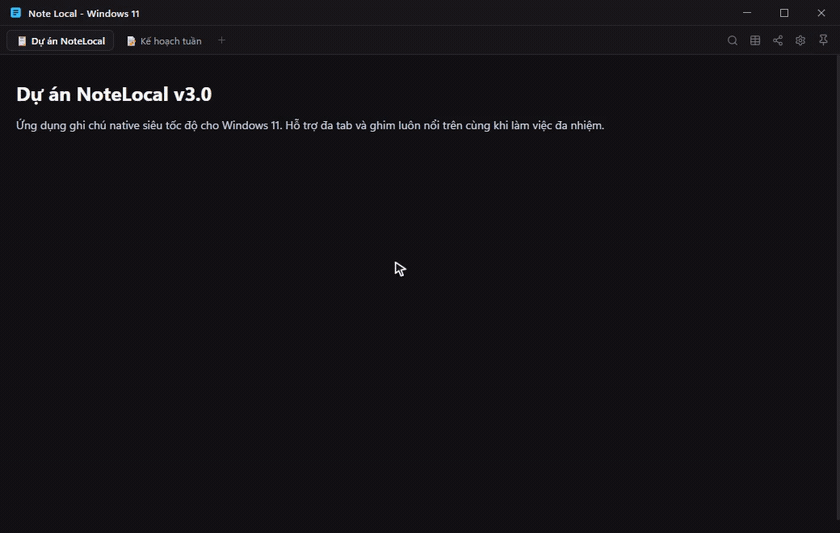
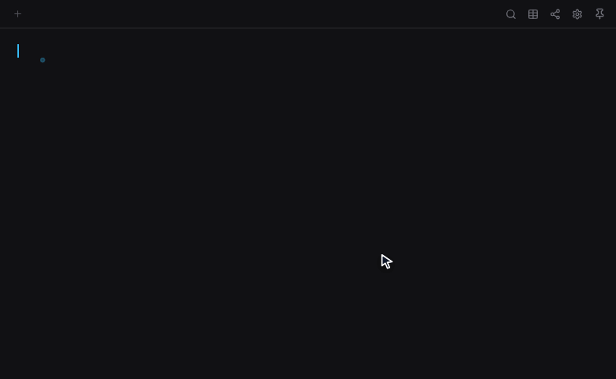
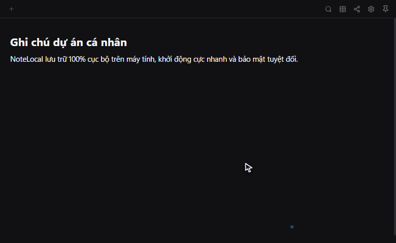
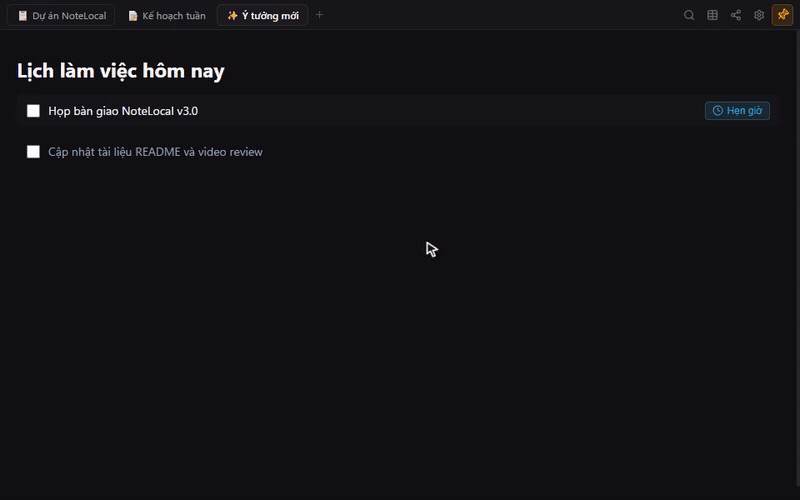
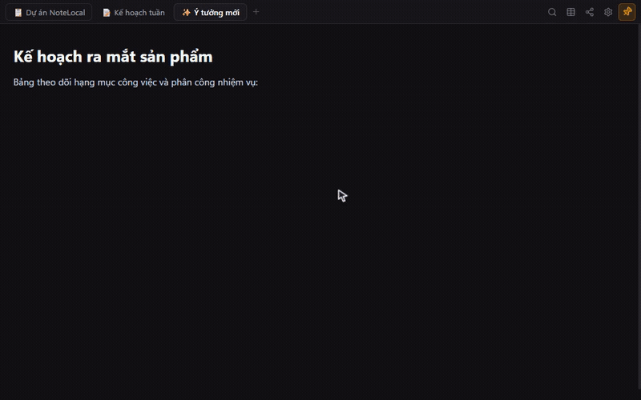
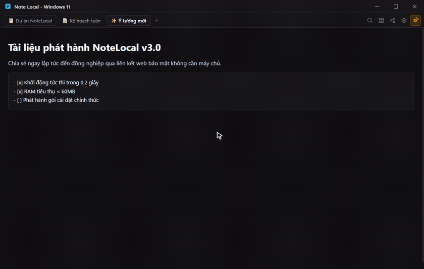

  

<h1 align="center">Note Local</h1>

  <b>Ứng dụng ghi chú siêu nhẹ, phong cách Notion, lưu trữ 100% cục bộ trên Windows</b> 
  Khởi động tức thì • RAM tiêu thụ &lt; 60MB • Không cần tài khoản • Bảo mật tuyệt đối trên máy của bạn

  
  
  
  
  
  

  
  &nbsp;&nbsp;
  

---

## 💡 NoteLocal là gì?

**NoteLocal** là ứng dụng ghi chú cá nhân dành cho người dùng Windows yêu thích trải nghiệm trực quan của **Notion** nhưng muốn tốc độ mượt mà, khởi động tức thì và toàn quyền kiểm soát dữ liệu của mình.

Được xây dựng bằng C++17 native tối ưu hóa sâu, NoteLocal tiêu thụ **chưa tới 60MB RAM** (thay vì 500MB–1GB như các ứng dụng nền Electron). Toàn bộ ghi chú được lưu dưới dạng tệp văn bản thuần Markdown (`.md`) trực tiếp trên ổ cứng máy tính của bạn — không phụ thuộc đám mây, không lo mất mạng và không bị khóa vào bất kỳ hệ sinh thái độc quyền nào.

  

---

## ✨ Điểm nổi bật dành cho bạn

### ⚡ 1. Siêu nhẹ, Đa tab & Ghim Always on Top

  

<a href="resources/demos/demo-tabs-pin.mp4"><i>🎥 Xem video 60fps MP4</i></a>

- Khởi động chỉ trong **0.2 giây**, sẵn sàng ghi chép ngay lập tức.
- Bộ nhớ tiêu thụ luôn duy trì dưới **60MB RAM**, chạy mượt mà ngay cả trên máy tính văn phòng cấu hình yếu.
- **Quản lý đa Tab trực quan**: Tạo tab mới với <kbd>Ctrl</kbd> + <kbd>N</kbd>, tìm kiếm tab siêu tốc bằng <kbd>Ctrl</kbd> + <kbd>/</kbd>.
- **Ghim luôn nổi trên cùng (Always on Top)**: Nhấn biểu tượng Ghim ở thanh tiêu đề để cửa sổ ghi chú luôn hiển thị trên các ứng dụng khác khi bạn tra cứu thông tin.

### 🪄 2. Trải nghiệm soạn thảo phong cách Notion

  

<a href="resources/demos/demo-notion-blocks.mp4"><i>🎥 Xem video 60fps MP4</i></a>

- **Kéo thả khối (Drag & Drop)**: Rê chuột vào lề trái để thấy tay cầm `⋮⋮`. Nhấc và kéo thả để sắp xếp lại các đoạn văn bản một cách trực quan với đường kẻ xanh dẫn hướng.
- **Tự động mở rộng Markdown**:
  - Gõ `- ` hoặc `* ` $\rightarrow$ Tự biến thành danh sách gạch đầu dòng (Bullet list).
  - Gõ `1. ` $\rightarrow$ Tự biến thành danh sách đánh số thứ tự.
  - Gõ `[] ` $\rightarrow$ Tự biến thành ô việc cần làm (Checklist To-Do).
  - Gõ `# `, `## `, `### ` $\rightarrow$ Tự biến thành Tiêu đề Lớn / Vừa / Nhỏ.
  - Gõ `> ` $\rightarrow$ Tự biến thành Khối trích dẫn (Quote).
  - Gõ `---` $\rightarrow$ Chèn vạch kẻ ngang phân cách.
- **Phím tắt chuẩn Notion**: Nhấn <kbd>Enter</kbd> trên dòng To-Do sinh tiếp việc mới; nhấn <kbd>Enter</kbd> trên dòng rỗng tự thoát ra đoạn văn thường; nhấn <kbd>Backspace</kbd> ở đầu khối rỗng tự chuyển về văn bản thường.
- **Menu lệnh chéo (Slash Menu `/`)**: Gõ `/` tại đầu dòng để chọn nhanh mọi khối nội dung: Việc cần làm, Tiêu đề, Bảng biểu, Trích dẫn, Hộp ghi chú nổi bật (Callout) hoặc Hỏi AI.
- **Thanh công cụ nổi (Bubble Toolbar)**: Bôi đen chữ để nhanh chóng định dạng **In đậm**, *In nghiêng*, ~~Gạch ngang~~, Đặt liên kết hoặc Gửi cho AI xử lý.

### 🤖 3. Trợ lý Trí tuệ Nhân tạo thông minh

  

<a href="resources/demos/demo-ai-assistant.mp4"><i>🎥 Xem video 60fps MP4</i></a>

- **Tự động nhận diện API Key (Key Sniffer)**: Bạn chỉ cần dán khóa API vào ô Cài đặt, NoteLocal sẽ tự động phát hiện nhà cung cấp tương ứng (Google Gemini, OpenAI, DeepSeek, Groq) mà không cần chỉnh tay phức tạp.
- **Hỗ trợ Google Gemini 2.5 Flash**: Tận dụng model AI mới nhất của Google qua endpoint tốc độ cao, trả lời thông minh và súc tích bằng tiếng Việt.
- **Hỗ trợ Local AI (Ollama)**: Kết nối với Ollama chạy trên máy bạn để dùng AI hoàn toàn ngoại tuyến (offline), miễn phí và bảo mật dữ liệu 100%.
- **Thanh tác vụ AI nhanh (<kbd>Ctrl</kbd> + <kbd>J</kbd>)**: Viết tiếp suy nghĩ, tóm tắt ý chính, sửa lỗi chính tả ngữ pháp hoặc dịch sang tiếng Anh chỉ bằng 1 cú nhấp.

### ⏰ 4. Hẹn giờ nhắc việc với Thông báo Windows Native

  

<a href="resources/demos/demo-reminders.mp4"><i>🎥 Xem video 60fps MP4</i></a>

- Gõ cú pháp tự nhiên như: `[] Gặp đối tác @14:30 15/11` hoặc `[] Họp bàn giao @15:30`.
- Hệ thống tự nhận diện và gắn thẻ nhắc việc trực quan. Nhấp vào thẻ để chọn nhanh preset 15 phút, 1 giờ hoặc ngày mai.
- Khi đến thời điểm, **Windows Action Center** sẽ gửi thông báo Toast ở góc màn hình ngay cả khi ứng dụng đang thu nhỏ.

### 📊 5. Bảng biểu phong cách Office (Table)

  

<a href="resources/demos/demo-tables.mp4"><i>🎥 Xem video 60fps MP4</i></a>

- Chèn bảng nhanh từ 2x2 đến 6x6.
- Kéo thả mép cột để thay đổi độ rộng theo ý thích.
- Nhấn phím <kbd>Tab</kbd> để di chuyển mượt mà giữa các ô; nhấn <kbd>Tab</kbd> ở ô cuối cùng sẽ **tự động thêm hàng mới** chuẩn như Microsoft Word.

### 🌐 6. Chia sẻ ghi chú 1-Click (Không cần máy chủ)

  

<a href="resources/demos/demo-share-web.mp4"><i>🎥 Xem video 60fps MP4</i></a>

- Nhấn vào biểu tượng **Chia sẻ** (Share): Đường link xem trực tuyến lập tức được tạo và tự động sao chép vào Clipboard của bạn.
- Người nhận mở link trên điện thoại hoặc máy tính để đọc ghi chú hiển thị đầy đủ văn bản, hình ảnh, checkbox thông qua trình xem web tĩnh bảo mật.

---

## ⌨️ Bảng phím tắt hữu dụng

| Phím tắt | Vị trí | Chức năng |
| :--- | :--- | :--- |
| <kbd>Ctrl</kbd> + <kbd>N</kbd> | Toàn ứng dụng | Tạo ghi chú mới trong Tab mới |
| <kbd>Ctrl</kbd> + <kbd>Tab</kbd> | Toàn ứng dụng | Chuyển sang Tab kế tiếp |
| <kbd>Ctrl</kbd> + <kbd>Shift</kbd> + <kbd>Tab</kbd> | Toàn ứng dụng | Chuyển lùi về Tab trước |
| <kbd>Ctrl</kbd> + <kbd>/</kbd> | Toàn ứng dụng | Mở hộp tìm kiếm nhanh Tab |
| <kbd>Ctrl</kbd> + <kbd>J</kbd> | Soạn thảo | Mở thanh Trợ lý AI (Prompt Bar) |
| <kbd>/</kbd> | Đầu dòng | Mở danh mục lệnh Slash Menu |
| <kbd>[]</kbd> | Đầu dòng | Tạo ô việc cần làm (To-Do Checkbox) |
| <kbd>-</kbd> hoặc <kbd>*</kbd> | Đầu dòng | Tạo danh sách gạch đầu dòng (Bullets) |
| <kbd>1.</kbd> | Đầu dòng | Tạo danh sách đánh số thứ tự |
| <kbd>Tab</kbd> / <kbd>Shift</kbd> + <kbd>Tab</kbd> | Danh sách / Bảng | Thụt dòng / Lùi dòng danh sách; Chuyển ô bảng |
| <kbd>Double-click</kbd> ảnh | Soạn thảo | Phóng to ảnh toàn màn hình (Lightbox) |
| <kbd>Esc</kbd> | Toàn ứng dụng | Đóng nhanh mọi Menu, Hộp thoại và Thanh AI |

---

## 📥 Hướng dẫn Cài đặt & Gỡ cài đặt

### Cài đặt:
1. Nhấp tải file cài đặt: [**`NoteLocal-Setup-x64.exe`**](https://github.com/michaeltran8386/note-app/releases/latest/download/NoteLocal-Setup-x64.exe) (dung lượng chỉ **2.45 MB**).
2. Click mở tệp tin vừa tải về và chọn **Install**.
3. Quá trình cài đặt diễn ra trong đúng **1 giây**, tự động tạo biểu tượng ngoài màn hình Desktop và trong Start Menu.
4. *Lưu ý*: Ứng dụng là **User-Level Installer** (cài vào thư mục người dùng), hoàn toàn **không đòi quyền Quản trị viên (UAC Administrator)**, an toàn tuyệt đối khi sử dụng trên máy tính cơ quan hay máy cá nhân.

### Gỡ cài đặt:
Nếu bạn không còn nhu cầu sử dụng, bạn có thể gỡ bỏ NoteLocal sạch sẽ bất kỳ lúc nào:
* Vào **Windows Settings** $\rightarrow$ **Apps** $\rightarrow$ **Installed apps** $\rightarrow$ Tìm **Note Local** $\rightarrow$ Chọn **Uninstall**.

---

## 👨‍💻 Dành cho Lập trình viên (Developers)

Nếu bạn là lập trình viên muốn tự biên dịch từ mã nguồn, chạy kiểm thử hoặc tìm hiểu kiến trúc C++17 và WebView2 của dự án:
* Vui lòng xem tài liệu kỹ thuật chi tiết tại: [**DEVELOPMENT.md**](DEVELOPMENT.md).

---

## 📄 Bản quyền (License)

NoteLocal là phần mềm mã nguồn mở miễn phí, được phát hành theo giấy phép **[MIT License](LICENSE)**. Bạn có quyền tự do sử dụng, tùy chỉnh và phân phối cho mục đích cá nhân lẫn thương mại.
