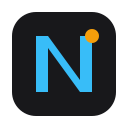

<p align="center">
  
</p>

<h1 align="center">Note Local</h1>

<p align="center">
  <b>Ứng dụng ghi chú siêu tối giản (Ultra-Minimalist) cho Windows 11 & 10</b><br>
  Được xây dựng bằng C++17 Native và Microsoft WebView2 Runtime.<br>
  Tốc độ khởi động tức thì, RAM &lt; 60MB, lưu trữ Markdown 100% cục bộ, bảo mật tuyệt đối không phụ thuộc server.
</p>

<p align="center">
  <a href="https://github.com/michaeltran8386/note-app"></a>
  
  
  
  
  
  
  
</p>

<p align="center">
  <a href="https://github.com/michaeltran8386/note-app/releases/latest/download/NoteLocal-Setup-x64.exe">
    
  </a>
  &nbsp;&nbsp;
  <a href="https://github.com/michaeltran8386/note-app/releases">
    
  </a>
</p>

---

## 📦 Tải về & Cài đặt 1-Click (User-Level Installer)

NoteLocal được đóng gói thành **1 tệp cài đặt `.exe` duy nhất** cực nhẹ (chỉ **2.45 MB**), mang lại trải nghiệm cài đặt mượt mà hệt như VS Code hay Sonora:
- 🚀 **Cài đặt trong 1 giây**: Chỉ cần tải file `NoteLocal-Setup-x64.exe` và nhấp cài đặt.
- 🛡️ **Không đòi quyền Administrator (Zero UAC Prompt)**: Tự động cài vào `%LocalAppData%\Programs\NoteLocal`, an toàn tuyệt đối cho máy tính công ty hoặc cá nhân.
- 🖥️ **Tự động tạo biểu tượng**: Tạo sẵn Shortcut trên Màn hình chính (Desktop) và Start Menu Windows 11.
- 🧹 **Gỡ cài đặt sạch sẽ**: Tích hợp chuẩn trong Windows Settings $\rightarrow$ Installed Apps.

---

## ✨ Điểm nổi bật & Tính năng cốt lõi

- ⚡ **Siêu nhẹ & Hiệu năng đỉnh cao**: Viết bằng C++17 và Win32 API native kết hợp Microsoft Edge WebView2 Evergreen, thời gian khởi động < 0.2s, bộ nhớ RAM tiêu thụ luôn dưới **60MB** (không giật lag, không ngốn tài nguyên như Electron hay Chromium cồng kềnh).
- 🪄 **Trải nghiệm tương tác mượt mà phong cách Notion (Mini-Notion UX)**:
  - **Tự động mở rộng Markdown siêu tốc (Markdown Auto-expansion)**: Gõ `- ` hoặc `* ` tạo bullet; `1. ` tạo danh sách số; `[] ` tạo checkbox; `# `, `## `, `### ` tạo Heading 1/2/3; `> ` tạo trích dẫn; `---` tạo vạch kẻ ngang. Con trỏ soạn thảo luôn được bảo toàn vị trí ổn định tuyệt đối, không bị giật trỏ.
  - **Quy tắc Enter & Backspace thông minh**: Nhấn <kbd>Enter</kbd> trên dòng việc cần làm sinh việc cần làm mới; nhấn <kbd>Enter</kbd> trên dòng trống tự động thoát ra đoạn văn thường `<p>`; nhấn <kbd>Backspace</kbd> ở đầu khối rỗng chuyển đổi êm ái về đoạn văn bình thường.
  - **Kéo thả khối vật lý (HTML5 Drag & Drop)**: Tay cầm `⋮⋮` ở lề trái hỗ trợ kéo thả trực tiếp (`draggable="true"`), hiển thị đường kẻ xanh chỉ thị vị trí thả (`.block-drop-line`), tự động sắp xếp lại vị trí khối và lưu dữ liệu tức thì.
  - **Thanh công cụ nổi ngữ cảnh (Selection Bubble Toolbar)**: Bôi đen văn bản bất kỳ để kích hoạt thanh công cụ nổi ngay trên con trỏ chuột: **In đậm** (`B`), *In nghiêng* (`I`), ~~Gạch ngang~~ (`S`), Tạo việc cần làm (`[]`), Danh sách gạch đầu dòng (`•`), Chèn liên kết (`🔗`), và Gọi trợ lý AI (`✨ AI`). Không bao giờ bị mất vùng chọn khi nhấn nút.
  - **Menu lệnh chéo (Slash Command `/`)**: Gõ `/` tại đầu dòng để mở danh mục lệnh trực quan: Văn bản thường, Ô việc cần làm, Gạch đầu dòng, Đánh số thứ tự, Tiêu đề H1/H2, Bảng biểu (Table), Trích dẫn (Quote), Hộp ghi chú (Callout), Đường kẻ ngang (Divider), và Trợ lý AI.
- 🤖 **Trợ lý AI thông minh (Local Ollama & Google Gemini 2.5 / OpenAI / DeepSeek / Groq)**:
  - **Tự động nhận diện khóa API (Key Sniffer)**: Tự động phát hiện loại khóa khi dán vào ô Cloud API Key (`AQ.` / `AIzaSy` $\rightarrow$ Gemini 2.5 Flash, `gsk_` $\rightarrow$ Groq, `sk-` $\rightarrow$ OpenAI/DeepSeek) và tự động chuyển sang chế độ Cloud AI.
  - **Google Gemini 2.5 Flash**: Cập nhật model tối tân nhất của Google qua chuẩn OpenAI-compatible, độ trễ cực thấp, thông minh và súc tích.
  - **Local AI (Ollama)**: Kết nối cục bộ qua `http://localhost:11434/v1`, chạy 100% offline, miễn phí, bảo mật tối đa.
  - **Thanh lệnh AI siêu tốc (<kbd>Ctrl</kbd> + <kbd>J</kbd> hoặc gõ `/ai`)**: Kèm sẵn các chip tác vụ 1-click (*Viết tiếp*, *Tóm tắt*, *Sửa lỗi chính tả & văn phong*, *Dịch sang tiếng Anh*) và ô nhập yêu cầu tự do.
- 🖥️ **Giao diện Windows 11 Native & Triệt tiêu Context Menu trình duyệt**:
  - Tắt hoàn toàn menu chuột phải mặc định của Edge (`put_AreDefaultContextMenusEnabled(FALSE)`), mang lại cảm giác ứng dụng Windows 11 thuần khiết, sạch sẽ, không có bất kỳ menu trình duyệt thừa thãi nào.
- 🎨 **Chuẩn giao diện Windows 11 & Biểu tượng Native**: Hỗ trợ bo góc DWM, dark mode native tinh tế, thanh tab tối giản tuyệt đối, tích hợp bộ biểu tượng ứng dụng Windows Native Icon (`app.ico`) chuẩn mọi độ phân giải (16x16 đến 256x256).
- 📊 **Bảng biểu phong cách Office (Tables - Word / Excel / Notion)**:
  - **Tạo bảng trực quan**: Nhấp biểu tượng Table để chọn kích thước qua lưới 6x6 hoặc chọn nhanh preset (`2x2`, `3x3`, `4x3`, `5x4`).
  - **Kéo chỉnh kích thước cột thời gian thực**: Từng cột tích hợp thanh kéo `.col-resizer`, điều chỉnh độ rộng cột mượt mà bằng chuột.
  - **Thao tác nhanh chuẩn Office**: Nút `+` ở mép phải để thêm cột, nút `+` ở đáy bảng để thêm hàng.
  - **Phím tắt `Tab` thông minh**: Nhấn `Tab` để di chuyển nhanh giữa các ô; nhấn `Tab` ở ô cuối cùng sẽ **tự động thêm hàng mới** (chuẩn hành vi Word & Notion). Nhấn `Shift + Tab` để lùi lại ô trước.
  - **Menu ngữ cảnh chuột phải**: Nhấp chuột phải vào bất kỳ ô nào để thêm hàng/cột, xóa hàng/cột hoặc xóa toàn bộ bảng.
  - **Cơ chế tự sửa (Self-healing HTML)**: Giữ toàn vẹn cấu trúc bảng kể cả khi chèn liên kết hay nội dung đa dòng, không bao giờ bị lỗi vỡ khung.
- 🔗 **Liên kết Bookmark Tối giản & Tự động nhận diện (Auto-detect Links)**:
  - **Tự động nhận diện thông minh**: Gõ hoặc dán trực tiếp bất kỳ URL nào (`https://...` hoặc `http://...`) rồi nhấn dấu cách hoặc <kbd>Enter</kbd>, hệ thống sẽ biến ngay thành liên kết thông minh màu xanh thanh lịch với gạch chân tinh tế mà không cần gõ tiền tố cú pháp.
  - **Dán nhiều link cùng lúc**: Tự động nhận biết danh sách nhiều đường link khi paste, tách từng dòng thành từng thẻ liên kết độc lập, không bị nối dính chuỗi.
  - **Tương thích ngược**: Vẫn hỗ trợ đầy đủ cú pháp kinh điển `> https://url` hoặc `> [tên]<url>`.
  - **Chỉnh sửa linh hoạt**: Rê chuột lên liên kết xuất hiện nút bút chì (✏️); nhấp vào sẽ mở popover với 2 ô nhập: *Tên hiển thị* và *Đường link URL*, kèm nút Xóa liên kết.
  - **Hỗ trợ toàn diện trong Bảng**: Hoạt động mượt mà cả trong đoạn văn thường lẫn bên trong từng ô Table (`<td>`).
- 🖼️ **Dán ảnh siêu tốc & Chống giật lag (Zero-lag Canvas Compression)**:
  - Tự động nén ảnh từ Clipboard bằng Canvas downscaling (tối đa 1440px, JPEG 0.85) giảm **95% dung lượng** (từ 20-30MB bitmap thô xuống ~150KB), triệt tiêu hoàn toàn tình trạng khựng giật DWM của Windows.
  - **Kích thước mặc định 30%**: Ảnh dán vào mặc định ở mức 30% gọn gàng, đồng bộ giữa App Editor và Web Viewer.
  - **Hộp công cụ co giãn ảnh**: Chọn nhanh `30%`, `60%`, `100%` hoặc kéo tự do ở góc ảnh để phóng to/thu nhỏ.
  - **Phóng to sắc nét (Lightbox)**: **Nhấp đúp chuột (Double-click)** vào ảnh bất kỳ để xem toàn màn hình.
- ⏰ **To-Do List, Danh sách Gạch đầu dòng (Bullets) & Hẹn giờ nhắc việc**:
  - **Danh sách gạch đầu dòng (Bullet Points)**: Gõ `- ` hoặc `* ` ở đầu dòng để tự động tạo danh sách gạch đầu dòng với dấu chấm tròn màu cyan thanh lịch.
  - **Danh sách đánh số (Numbered Lists)**: Gõ `1. ` ở đầu dòng để tự động tạo danh sách số thứ tự tăng dần.
  - **Thao tác danh sách mượt mà chuẩn Office/Notion**:
    - Nhấn <kbd>Enter</kbd> để tạo dòng bullet tiếp theo.
    - Nhấn <kbd>Enter</kbd> tại dòng bullet trống để **tự động thoát danh sách** và quay về đoạn văn bản bình thường.
    - Nhấn <kbd>Backspace</kbd> ở đầu dòng bullet để đưa về văn bản thường.
    - Nhấn <kbd>Tab</kbd> để thụt dòng thành cấp con (Indent), nhấn <kbd>Shift + Tab</kbd> để lùi cấp (Outdent).
    - Phân biệt độc lập 100% với To-Do Checkbox (`- [ ]`), không bao giờ bị xung đột cú pháp.
  - **To-Do Checkbox**: Gõ `[]` để tạo ô việc cần làm (Checkbox To-Do).
  - **Nhận diện cú pháp hẹn giờ tự nhiên**: gõ `@14:30 15/11`, `@09:00`, `@mai 08:30`... Hệ thống tự tạo badge đồng hồ hẹn giờ.
  - Hộp thoại chọn ngày giờ tùy chỉnh kèm các nút tắt tiện lợi `+15 phút`, `+1 giờ`, `Ngày mai 09:00`.
  - **Thông báo Windows Native**: Windows 10/11 Action Center bật thông báo Toast nổi ngay cả khi ứng dụng đang ẩn. Nhấp vào thông báo sẽ tự động mở lại ghi chú và đưa con trỏ đến đúng dòng công việc.
- 📑 **Quản lý đa Tab trực quan & Tìm kiếm siêu tốc**:
  - Tạo tab mới (`Ctrl + N`), đổi tên tab khi nhấp đúp, chuyển tab tuần hoàn (`Ctrl + Tab` / `Ctrl + Shift + Tab`).
  - **Tìm kiếm tab nhanh (`Ctrl + /`)**: Gõ tìm theo tên tab và dùng phím mũi tên để nhảy tab tức thì.
- 📌 **Ghim cửa sổ (Always on Top)**: Giữ cửa sổ ghi chú luôn nổi trên các ứng dụng khác khi cần tra cứu/lập kế hoạch.
- 🌐 **Chia sẻ Web 1-Click Serverless & Hợp nhất 2 chiều (Share & Merge)**:
  - **1-Click Share & Tự động sao chép Clipboard**: Chỉ 1 cú nhấp vào icon Share, link web được tạo tức thì và nạp thẳng vào Clipboard của bạn kèm thông báo Toast xác nhận.
  - **Tự động rút gọn TinyURL**: Tích hợp rút gọn link nền thông minh qua C++ WinINet cho các ghi chú văn bản, giúp link ngắn gọn và chuyên nghiệp khi chia sẻ qua tin nhắn.
  - **Mã hóa URL Hash 100% Client-side**: Xuất bản ghi chú siêu nhẹ bằng URL Hash `#<deflate-raw base64url>`, hoạt động hoàn toàn không cần server (Zero-backend), không cần cơ sở dữ liệu.
  - **Hợp nhất phiên bản chỉnh sửa (Merge Note)**: Người nhận có thể mở link trên web, chỉnh sửa trực tiếp và gửi lại URL. Bạn dán vào NoteLocal để "Áp dụng vào Tab này" hoặc "Tạo Tab mới", hỗ trợ dán hàng loạt link mở nhiều tab cùng lúc.
  - Người nhận mở trên điện thoại hay máy tính xem được trọn vẹn văn bản, checkbox, bảng biểu và toàn bộ hình ảnh sắc nét thông qua Web Viewer trên GitHub Pages (`docs/`).
- 🔒 **Bảo mật & Cục bộ**: Toàn bộ dữ liệu ghi chú (`.md`), cấu hình (`config.json`) và hình ảnh (`assets/`) nằm hoàn toàn trên ổ cứng máy bạn.

---

## 🚀 Hướng dẫn sử dụng chi tiết

### 1. Khởi chạy ứng dụng
Sau khi tải hoặc biên dịch:
- Chạy tệp tin: `build/bin/NoteLocal.exe`.
- Cửa sổ ứng dụng sẽ xuất hiện ngay lập tức và tự động khôi phục tab đang mở gần nhất.

---

### 2. Soạn thảo văn bản, Bullet Points, To-Do List & Hẹn giờ nhắc việc
- **Tự động lưu**: Mọi thao tác gõ văn bản được tự động lưu ngầm vào file `.md` sau 300ms (debounce).
- **Tạo danh sách gạch đầu dòng (Bullet Points)**:
  - Gõ `- ` hoặc `* ` ở đầu dòng rồi gõ nội dung -> Tự động chuyển thành thẻ danh sách với dấu bullet tròn màu cyan.
  - Nhấn <kbd>Enter</kbd> để tạo dòng bullet tiếp theo.
  - Nhấn <kbd>Enter</kbd> trên dòng bullet trống: Tự động thoát danh sách và trở về văn bản thường.
  - Nhấn <kbd>Backspace</kbd> ở đầu dòng: Chuyển thẻ bullet thành dòng văn bản thường.
  - Nhấn <kbd>Tab</kbd>: Thụt lề cấp con (Indent).
  - Nhấn <kbd>Shift</kbd> + <kbd>Tab</kbd>: Lùi cấp lề (Outdent).
- **Tạo danh sách đánh số (Numbered Lists)**:
  - Gõ `1. ` ở đầu dòng rồi gõ nội dung -> Tự động tạo danh sách số thứ tự.
  - Thao tác <kbd>Enter</kbd>, <kbd>Backspace</kbd>, <kbd>Tab</kbd> tương tự danh sách bullet.
- **Tạo ô Checkbox việc cần làm (To-Do List)**:
  - Gõ hai ký tự `[]` liền nhau -> Hệ thống tự động chuyển đổi thành ô Checkbox.
  - Nhấp vào ô vuông để đánh dấu hoàn thành (chữ tự động gạch ngang và mờ đi).
  - Nhấn <kbd>Enter</kbd> tại dòng To-Do để tự động tạo tiếp dòng To-Do mới bên dưới.
  - Nhấn <kbd>Backspace</kbd> khi ô To-Do trống để đưa dòng trở lại văn bản thường.
- **Hẹn giờ nhắc việc (Reminders)**:
  - **Cú pháp gõ nhanh**: Gõ `@HH:mm dd/MM` (ví dụ: `[] Nộp báo cáo tài chính @14:30 15/11` hoặc `@mai 09:00`). Hệ thống sẽ tự nhận diện và hiển thị thành badge đồng hồ màu xanh.
  - **Chọn thủ công**: Nhấp vào badge đồng hồ hoặc icon đồng hồ bên phải dòng To-Do để mở popup chọn Ngày và Giờ (kèm các nút tắt `+15 phút`, `+1 giờ`, `Ngày mai 09:00`).
  - **Thông báo Windows**: Khi đến giờ hẹn, Windows Action Center sẽ bật thông báo Toast nổi ở góc màn hình. Nhấp vào thông báo sẽ tự động khôi phục cửa sổ và đưa con trỏ đến đúng dòng công việc.
  - **Tự động hủy nhắc**: Khi bạn đánh dấu hoàn thành ô việc (`[x]`), lịch nhắc nhở của việc đó sẽ tự động được tắt.

---

### 3. Trải nghiệm tương tác phong cách Notion (Mini-Notion UX)
- **Thanh công cụ nổi ngữ cảnh (Selection Bubble Toolbar)**:
  - Khi bôi đen bất kỳ đoạn văn bản nào, thanh công cụ nhỏ gọn lập tức xuất hiện ngay phía trên vùng chọn.
  - Cung cấp các thao tác định dạng 1-click:
    - **`B`**: In đậm (`**nội dung**`).
    - **`I`**: In nghiêng (`*nội dung*`).
    - **`S`**: Gạch ngang (`~~nội dung~~`).
    - **`[]`**: Chuyển thành dòng Việc cần làm (To-Do Checkbox).
    - **`•`**: Chuyển thành dòng Gạch đầu dòng (Bullet Point).
    - **`🔗`**: Mở popover chèn hoặc sửa liên kết nhanh cho vùng chọn.
    - **`✨ AI`**: Mở thanh trợ lý AI với ngữ cảnh là chính đoạn văn bản vừa chọn.
- **Menu lệnh chéo (Slash Command `/`)**:
  - Gõ ký tự `/` ở đầu dòng hoặc sau dấu cách để mở danh mục lệnh trực quan:
    - `Văn bản thường (Text)`: Viết văn bản trơn.
    - `Việc cần làm (To-Do)`: Chèn ô checkbox công việc.
    - `Gạch đầu dòng (Bullet List)`: Danh sách chấm tròn.
    - `Đánh số (Numbered List)`: Danh sách số thứ tự.
    - `Tiêu đề lớn (Heading 1)`: Dòng `# Tiêu đề`.
    - `Tiêu đề vừa (Heading 2)`: Dòng `## Tiêu đề`.
    - `Bảng biểu (Table)`: Chèn bảng lưới 3x3 nhanh.
    - `Trích dẫn (Quote)`: Khối blockquote thanh lịch.
    - `Hộp ghi chú (Callout)`: Khối thông tin nổi bật với viền sáng.
    - `Đường phân cách (Divider)`: Đường kẻ ngang ngăn cách nội dung (`---`).
    - `Hỏi AI (AI Assistant)`: Kích hoạt thanh lệnh Trợ lý AI.
  - Gõ phím để lọc danh sách lệnh tức thời (ví dụ: gõ `/tab` sẽ lọc ra Table, `/ai` mở AI).
  - Sử dụng phím mũi tên <kbd>↑</kbd> <kbd>↓</kbd> để di chuyển và phím <kbd>Enter</kbd> để chọn lệnh; phím <kbd>Esc</kbd> để đóng menu.
- **Tay cầm thao tác khối (Block Handle `⋮⋮`)**:
  - Khi rê chuột qua các khối văn bản, biểu tượng `⋮⋮` thanh mảnh tự động xuất hiện ở lề trái của khối.
  - Nhấp chuột vào biểu tượng để mở Menu ngữ cảnh khối:
    - **Chuyển đổi kiểu khối**: Biến nhanh khối hiện tại thành *Việc cần làm*, *Gạch đầu dòng*, *Tiêu đề 1* hoặc *Văn bản thường*.
    - **Nhân bản khối (Duplicate)**: Tạo một bản sao y hệt ngay bên dưới.
    - **Xóa khối (Delete)**: Xóa nhanh toàn bộ nội dung của dòng hiện tại.

---

### 4. Trợ lý Trí tuệ Nhân tạo (Notion AI Assistant - Local & Cloud)
- **Tùy chọn cấu hình trong Cài đặt (Settings)**:
  - Nhấp vào biểu tượng bánh răng **Cài đặt** trên thanh Header để chọn chế độ AI:
    1. **Local AI (Ollama)**: Dành cho người dùng ưu tiên quyền riêng tư tuyệt đối và miễn phí. Mặc định kết nối tới `http://localhost:11434/v1` (tương thích OpenAI schema). Chọn model cài sẵn trong máy bạn (ví dụ: `llama3.2`, `mistral`, `qwen2.5`...).
    2. **Cloud AI (API Key ngoài)**: Hỗ trợ bất kỳ dịch vụ AI đám mây nào có API chuẩn OpenAI:
       - **Google Gemini**: Dùng endpoint OpenAI tương thích của Google (`https://generativelanguage.googleapis.com/v1beta/openai/`) kèm API Key của bạn.
       - **OpenAI**: Endpoint `https://api.openai.com/v1`, model `gpt-4o-mini`, `gpt-4o`.
       - **DeepSeek**: Endpoint `https://api.deepseek.com/v1`, model `deepseek-chat`.
       - **Groq**: Endpoint `https://api.groq.com/openai/v1`, model `llama-3.3-70b-versatile`.
    3. **Tắt trợ lý AI**: Ẩn hoàn toàn tính năng AI nếu không có nhu cầu sử dụng.
  - **Kiểm tra kết nối**: Cả 2 chế độ đều có nút *"Kiểm tra kết nối"* để bạn kiểm tra thông tuyến API trước khi sử dụng trong ghi chú.
- **Kích hoạt & Sử dụng thanh lệnh AI**:
  - Nhấn phím tắt <kbd>Ctrl</kbd> + <kbd>J</kbd>, gõ `/ai` trong Slash menu, hoặc bấm `✨ AI` trên Bubble Toolbar.
  - **Các chip tác vụ nhanh 1-Click**:
    - **Viết tiếp (Continue)**: AI tự đọc nội dung ghi chú phía trước và viết tiếp mạch suy nghĩ một cách tự nhiên.
    - **Tóm tắt (Summarize)**: Rút gọn các ý chính của đoạn văn bản hoặc toàn bộ ghi chú thành các gạch đầu dòng súc tích.
    - **Sửa lỗi chính tả & văn phong (Fix grammar)**: Tự động soát lỗi ngữ pháp tiếng Việt / tiếng Anh và trau chuốt câu từ chuẩn mực.
    - **Dịch sang tiếng Anh (Translate)**: Dịch trôi chảy nội dung đã chọn sang tiếng Anh chuyên nghiệp.
  - **Yêu cầu tự do (Custom Prompt)**: Nhập bất kỳ câu lệnh nào bạn muốn vào ô nhập và nhấn <kbd>Enter</kbd> (ví dụ: *"Lập dàn ý kế hoạch tuần tới"*, *"Liệt kê 5 ưu điểm của sản phẩm này"*).
  - **Chèn phản hồi Streaming trực tiếp**: Nội dung do AI sinh ra được phát trực tiếp (stream) từng từ vào ngay vị trí con trỏ trong ghi chú, mang lại cảm giác sống động và phản hồi tức thời.

---

### 5. Liên kết Bookmark Tối giản & Tự động nhận diện (Auto-detect Links)
- **Tự động nhận diện không cần cú pháp**:
  - Gõ hoặc dán thẳng bất kỳ đường link URL nào (ví dụ: `https://youtube.com` hay `https://github.com`) rồi nhấn phím <kbd>Space</kbd> hoặc phím <kbd>Enter</kbd>.
  - Đường link sẽ tự động chuyển hóa thành liên kết thông minh màu xanh thanh lịch với gạch chân trang nhã, nhấp vào để mở ngay trong trình duyệt mặc định của Windows.
- **Dán nhiều link cùng lúc (Batch Paste)**:
  - Sao chép danh sách gồm nhiều dòng URL và dán vào trình soạn thảo. Hệ thống tự động tách từng dòng thành từng thẻ liên kết độc lập, sạch sẽ và không bao giờ bị dính chuỗi.
- **Cú pháp thủ công (Tùy chọn tương thích ngược)**:
  - Bạn vẫn có thể dùng cú pháp `> https://url` hoặc `> [Tên hiển thị]<https://url>`.
- **Chỉnh sửa & Xóa liên kết**:
  - Rê chuột qua liên kết bất kỳ, nút bút chì (✏️) sẽ xuất hiện bên cạnh.
  - Nhấp vào nút bút chì để mở popover chỉnh sửa:
    - **Ô 1 (Tên hiển thị)**: Đổi tên hiển thị ngắn gọn (ví dụ: "Kênh YouTube").
    - **Ô 2 (Đường dẫn URL)**: Chỉnh sửa lại địa chỉ link.
    - **Nút Xóa (Thùng rác)**: Xóa liên kết và khôi phục văn bản thường.
- **Sử dụng toàn diện trong Bảng (Table)**: Bạn có thể gõ hoặc dán liên kết vào bất kỳ ô nào của bảng biểu, liên kết sẽ nằm gọn gàng bên trong ô mà không làm méo mó hay vỡ khung bảng.

---

### 6. Bảng biểu phong cách Office (Tables)
- **Chèn bảng mới**:
  - Nhấp vào biểu tượng **Table** trên thanh Header.
  - Rê chuột trên lưới 6x6 để chọn số hàng và số cột mong muốn, hoặc nhấp vào các nút preset nhanh (`2x2`, `3x3`, `4x3`, `5x4`).
- **Thay đổi độ rộng cột**:
  - Rê chuột vào mép phải của tiêu đề cột (`<th>`), con trỏ sẽ đổi thành dạng kéo giãn `col-resize`.
  - Nhấp giữ và kéo sang trái/phải để thu nhỏ hoặc mở rộng cột theo ý muốn.
- **Thêm hàng / cột nhanh**:
  - Nhấp vào nút `+` ở cạnh phải bảng: Thêm ngay 1 cột mới.
  - Nhấp vào nút `+` ở đáy bảng: Thêm ngay 1 hàng mới.
- **Phím tắt `Tab` tiện lợi**:
  - Nhấn <kbd>Tab</kbd>: Nhảy sang ô tiếp theo.
  - Khi đang ở ô cuối cùng của hàng cuối cùng, nhấn <kbd>Tab</kbd> sẽ **tự động chèn thêm một hàng mới** và đặt con trỏ vào ô đầu tiên của hàng mới đó.
  - Nhấn <kbd>Shift</kbd> + <kbd>Tab</kbd>: Lùi về ô phía trước.
- **Menu chuột phải (Context Menu)**:
  - Nhấp chuột phải vào bất kỳ ô nào trong bảng để chọn:
    - *Thêm hàng phía trên / Thêm hàng phía dưới*
    - *Thêm cột bên trái / Thêm cột bên phải*
    - *Xóa hàng hiện tại / Xóa cột hiện tại*
    - *Xóa toàn bộ bảng*

---

### 7. Chèn & Quản lý hình ảnh
- **Dán ảnh (Ctrl + V)**:
  - Chụp ảnh màn hình qua <kbd>Win</kbd> + <kbd>Shift</kbd> + <kbd>S</kbd> hoặc copy ảnh từ trình duyệt.
  - Nhấn <kbd>Ctrl</kbd> + <kbd>V</kbd> vào trình soạn thảo: Ảnh tự động được nén tối ưu (giảm 95% dung lượng) và lưu vào thư mục `assets/` với độ rộng mặc định 30%.
- **Chỉnh kích thước ảnh**:
  - Nhấp 1 lần vào ảnh để hiển thị khung chọn kích thước: `30%`, `60%`, hoặc `Vừa khung (100%)`.
  - Kéo chấm tròn ở góc dưới bên phải ảnh để co giãn tự do.
- **Phóng to xem ảnh gốc (Lightbox)**:
  - **Nhấp đúp (Double-click)** vào ảnh bất kỳ để mở chế độ xem toàn màn hình sắc nét.
  - Nhấn phím <kbd>Esc</kbd> hoặc click ra ngoài ảnh để đóng.

---

### 8. Quản lý Thẻ ghi chú (Tabs)
- **Tạo Tab mới**: Nhấn phím tắt <kbd>Ctrl</kbd> + <kbd>N</kbd> hoặc click nút `+` trên thanh tiêu đề.
- **Chuyển Tab tuần hoàn**:
  - <kbd>Ctrl</kbd> + <kbd>Tab</kbd>: Chuyển sang tab kế tiếp.
  - <kbd>Ctrl</kbd> + <kbd>Shift</kbd> + <kbd>Tab</kbd>: Chuyển lùi về tab phía trước.
- **Tìm kiếm Tab siêu tốc (`Ctrl + /`)**:
  - Nhấn <kbd>Ctrl</kbd> + <kbd>/</kbd> (hoặc click icon kính lúp trên header) để mở bảng tìm kiếm.
  - Nhập tên tab cần tìm; dùng phím mũi tên <kbd>↑</kbd> / <kbd>↓</kbd> để chọn và nhấn <kbd>Enter</kbd> để mở tab ngay lập tức.
- **Đổi tên Tab**: Nhấp đúp chuột vào tiêu đề tab, nhập tên mới và nhấn <kbd>Enter</kbd>.
- **Đóng Tab**: Rê chuột lên tab và nhấp vào biểu tượng `×`.

---

### 9. Ghim cửa sổ (Always on Top)
- Nhấp vào biểu tượng **Chiếc ghim** (Pin icon) ở góc phải thanh tiêu đề.
- Khi được ghim, biểu tượng chuyển sang màu vàng hổ phách (`#f59e0b`). Cửa sổ sẽ luôn nổi trên các ứng dụng khác.

---

### 10. Chia sẻ ghi chú Web Serverless & Hợp nhất 2 chiều (Share & Merge)
- **1-Click Chia sẻ & Tự động sao chép Clipboard**:
  - Nhấp vào nút **Chia sẻ** (icon `share-2` trên thanh tiêu đề).
  - Hệ thống nén toàn bộ văn bản, bảng biểu, ảnh bằng thuật toán `deflate-raw` và **tự động sao chép ngay đường link vào Clipboard của bạn**, đồng thời bật thông báo Toast xác nhận: *"Đã sao chép link Web vào Clipboard!"*. Bạn chỉ việc <kbd>Ctrl</kbd> + <kbd>V</kbd> gửi đi.
  - Với ghi chú thông thường (<= 2000 ký tự), C++ tự động kết nối API TinyURL rút gọn link siêu ngắn và cập nhật lại vào Clipboard.
  - Người dùng luôn có thể nhấp vào dòng *"Sao chép link đầy đủ (Offline Hash)"* để lấy đường link chứa 100% dữ liệu nén hoạt động hoàn toàn offline không phụ thuộc internet.
- **Trải nghiệm trên Web Viewer (Dành cho người nhận)**:
  - Người nhận mở link trên bất kỳ thiết bị nào (Chrome, Safari, Edge trên PC hay smartphone) đều xem được trọn vẹn văn bản, bảng biểu, ảnh với độ rộng chuẩn 30% và checkbox To-Do tương tác được.
  - Người nhận có thể bấm nút **"Soạn thảo"** trên thanh header của Web Viewer để chỉnh sửa trực tiếp, rồi bấm **"Chia sẻ"** để lấy URL đã cập nhật gửi ngược lại cho bạn.
- **Hợp nhất phiên bản chỉnh sửa từ người khác (Merge Note)**:
  - Nhấp vào nút **Chia sẻ** trên NoteLocal.exe để mở popover Share & Merge.
  - Tại mục **"2. Nhập bản chỉnh sửa từ người khác (Merge)"**, dán link nhận được vào ô văn bản:
    - Bấm **"Áp dụng vào Tab này"**: Cập nhật trực tiếp nội dung tab hiện tại theo bản sửa mới nhất.
    - Bấm **"Tạo Tab mới"**: Mở nội dung chia sẻ vào một Tab mới toanh để dễ dàng đối chiếu, so sánh mà không sợ ghi đè dữ liệu cũ.
  - **Mở hàng loạt link cùng lúc**: Bạn có thể dán danh sách nhiều link (mỗi dòng 1 URL), hệ thống sẽ tự động tạo hàng loạt Tab mới tương ứng chỉ với 1 cú click chuột.

> **💡 Cách bật GitHub Pages cho Repository (chỉ làm 1 lần):**
> 1. Truy cập repo của bạn: `https://github.com/michaeltran8386/note-app/settings/pages`
> 2. Tại mục **Build and deployment** -> **Source**: Chọn **Deploy from a branch**.
> 3. Chọn Branch `main` và thư mục `/docs` -> Bấm **Save**.
> 4. Sau vài giây, trang web của bạn sẽ chính thức hoạt động tại: `https://michaeltran8386.github.io/note-app/`!

---

## ⌨️ Bảng tra cứu phím tắt (Keyboard Shortcuts)

| Phím tắt | Vị trí / Ngữ cảnh | Thao tác |
| :--- | :--- | :--- |
| <kbd>Ctrl</kbd> + <kbd>/</kbd> | Toàn ứng dụng | Mở thanh tìm kiếm Tab nhanh (Tab Search) |
| <kbd>Ctrl</kbd> + <kbd>Tab</kbd> | Toàn ứng dụng | Chuyển tiếp sang tab tiếp theo (Cycle forward) |
| <kbd>Ctrl</kbd> + <kbd>Shift</kbd> + <kbd>Tab</kbd> | Toàn ứng dụng | Chuyển lùi về tab trước (Cycle backward) |
| <kbd>Ctrl</kbd> + <kbd>N</kbd> | Toàn ứng dụng | Tạo tab ghi chú mới |
| <kbd>Ctrl</kbd> + <kbd>J</kbd> | Trình soạn thảo | Mở thanh nhập lệnh Trợ lý AI (Notion AI Prompt Bar) |
| `/` (Slash) | Đầu dòng / sau dấu cách | Mở menu lệnh nhanh (Text, To-Do, Bullet, Heading, Table, AI...) |
| Bôi đen văn bản | Trình soạn thảo | Hiện thanh công cụ nổi (Bubble Toolbar: B, I, S, [], •, 🔗, ✨ AI) |
| Rê chuột vào lề khối | Trình soạn thảo | Hiện tay cầm khối `⋮⋮` (Menu đổi loại khối, Nhân bản, Xóa) |
| `https://...` / `http://...` | Trình soạn thảo / Bảng | Tự động nhận diện và tạo liên kết thông minh |
| Dán danh sách link | Trình soạn thảo | Tự động tách từng URL thành từng thẻ liên kết riêng |
| `> https://...` | Trình soạn thảo / Bảng | Tạo link bookmark thủ công (tương thích ngược) |
| `[]` | Trình soạn thảo | Gõ `[]` để tạo ô việc cần làm (Checkbox To-Do) |
| `- ` hoặc `* ` | Trình soạn thảo | Gõ `- ` hoặc `* ` ở đầu dòng để tạo Bullet Point |
| `1. ` | Trình soạn thảo | Gõ `1. ` ở đầu dòng để tạo Danh sách đánh số |
| <kbd>Enter</kbd> (dòng bullet rỗng) | Trong danh sách | Thoát khỏi danh sách và trở về dòng văn bản thường |
| <kbd>Tab</kbd> / <kbd>Shift</kbd> + <kbd>Tab</kbd> | Trong danh sách | Thụt lề cấp con (Indent) / Lùi cấp lề (Outdent) |
| `@HH:mm dd/MM` | Dòng To-Do | Đặt lịch hẹn giờ nhắc việc tự động (Reminder) |
| <kbd>Backspace</kbd> | Dòng To-Do trống | Xóa ô To-Do và đưa về dạng dòng văn bản thường |
| <kbd>Enter</kbd> | Dòng To-Do | Tạo dòng việc cần làm tiếp theo bên dưới |
| <kbd>Tab</kbd> | Trong ô Bảng | Di chuyển sang ô tiếp theo (tự thêm hàng mới ở ô cuối cùng) |
| <kbd>Shift</kbd> + <kbd>Tab</kbd> | Trong ô Bảng | Lùi về ô trước đó |
| <kbd>Chuột phải</kbd> | Trong ô Bảng | Mở menu ngữ cảnh thêm/xóa hàng, cột, bảng |
| <kbd>Ctrl</kbd> + <kbd>V</kbd> | Trình soạn thảo | Dán ảnh từ clipboard (nén tối ưu 95%, mặc định 30% width) |
| <kbd>Double-click</kbd> vào ảnh | Trên ảnh | Mở Lightbox phóng to xem ảnh gốc toàn màn hình |
| <kbd>Double-click</kbd> vào Tab | Thanh Header | Mở hộp thoại đổi tên tab |
| <kbd>Esc</kbd> | Toàn ứng dụng | Đóng Slash Menu, Thanh AI, Bubble Toolbar, Popover Chia sẻ, Lightbox, Bảng |

---

## 📁 Cấu trúc thư mục dự án

```text
NOTE_LOCAL/
├── assets/                     # Nơi lưu trữ các hình ảnh dán từ clipboard (.png, .jpg)
├── notes/                      # Nơi lưu trữ nội dung ghi chú (.md) theo từng tab
├── resources/                  # Tài nguyên nhận diện thương hiệu (Logo SVG chuẩn, app.ico Native)
│   ├── app.ico                 # Biểu tượng Windows Icon đa kích thước (16x16 -> 256x256)
│   ├── app.rc                  # Windows Resource Script gán IDI_APP_ICON
│   └── logo/logo.svg           # Logo SVG gốc chuẩn tỷ lệ 100/100
├── specs/                      # Đặc tả kỹ thuật chi tiết (spec, plan, data model, tasks)
│   └── 001-unified-notes-reminders/
├── docs/                       # Web Viewer & Tài liệu kỹ thuật
│   ├── notion_outputs_reference/ # Bộ 6 tài liệu đảo ngược Notion Desktop bằng REA
│   ├── superpowers/plans/      # Bản kế hoạch thiết kế và thực thi tính năng
│   ├── index.html              # Trang web xem ghi chú công khai
│   ├── app.js                  # Bộ giải nén client-side deflate-raw base64url & Markdown renderer
│   └── style.css               # Phong cách giao diện dark-mode cho Web Viewer
├── src/
│   ├── core/                   # Logic nghiệp vụ độc lập C++
│   │   ├── note_model.h        # Cấu trúc dữ liệu Note, Tab, Reminder, TodoItem
│   │   ├── markdown_engine.h/cpp # Bộ tuần tự hóa Markdown, Table, Image, Links, Reminders
│   │   ├── reminder_manager.h/cpp # Quản lý và lập lịch nhắc hẹn theo thời gian thực
│   │   └── share_service.h/cpp   # Dịch vụ chia sẻ ghi chú và tạo URL hash
│   ├── platform/               # Tầng tương tác hệ điều hành Windows
│   │   ├── window_controller.h/cpp # Xử lý cửa sổ Win32, DWM dark mode, Always on Top, Taskbar Icon
│   │   ├── webview_host.h/cpp      # Điều khiển WebView2 Runtime
│   │   ├── notification_service.h/cpp # Windows Toast Notification & System Tray Icon
│   │   └── ipc_message.h/bridge.h  # Cầu nối truyền thông điệp JSON giữa C++ và WebView2
│   ├── ui/assets/              # Giao diện người dùng HTML5, CSS3, Vanilla JS
│   │   ├── index.html          # Cấu trúc DOM siêu tối giản (Editor, Popover bảng, Link Popover)
│   │   ├── style.css           # Bảng phong cách dark-mode Windows 11
│   │   └── editor.js           # Xử lý tương tác bảng, dán ảnh nén Canvas, links, to-do, tabs
│   └── main.cpp                # Điểm khởi chạy WinMain, vòng lặp thông điệp Windows
├── tests/                      # Bộ kiểm thử đơn vị tự động (8/8 test suites pass 100%)
│   ├── unit/                   # Kiểm thử reminder parser, reminder manager, share contract
│   ├── test_markdown_engine.cpp # Kiểm thử tuần tự hóa Markdown, Table, Links và Image
│   ├── test_storage_manager.cpp # Kiểm thử đọc ghi tệp tin và cấu hình
│   ├── test_window_controller.cpp
│   └── test_ipc_message.cpp
├── CMakeLists.txt              # Cấu hình biên dịch CMake đa nền tảng
└── README.md                   # Tài liệu hướng dẫn sử dụng và phát triển
```

---

## 🛠️ Hướng dẫn cài đặt & Biên dịch (Build from Source)

### Yêu cầu môi trường:
- **Hệ điều hành**: Windows 10/11 (64-bit).
- **Trình biên dịch C++**: Hỗ trợ C++17 (LLVM-MinGW, Clang, GCC hoặc MSVC).
- **CMake**: Phiên bản 3.20 trở lên.
- **Microsoft Edge WebView2 Runtime**: Đã tích hợp sẵn trên Windows 11 và Windows 10 cập nhật mới nhất.

### Các bước biên dịch:

```powershell
# 1. Clone repository
git clone https://github.com/michaeltran8386/note-app.git
cd note-app

# 2. Tạo thư mục build và cấu hình CMake
cmake -B build -G "Ninja"  # Hoặc -G "MinGW Makefiles" / MSVC

# 3. Biên dịch ứng dụng chính
cmake --build build --target NoteLocal

# 4. Chạy toàn bộ 8 bộ kiểm thử đơn vị tự động (Unit Tests)
.\build\bin\test_markdown_engine.exe
.\build\bin\test_reminder_parser.exe
.\build\bin\test_reminder_manager.exe
.\build\bin\test_storage_manager.exe
.\build\bin\test_share_contract.exe
.\build\bin\test_window_controller.exe
.\build\bin\test_ipc_message.exe
.\build\bin\test_runner.exe

# 5. Khởi chạy ứng dụng
.\build\bin\NoteLocal.exe
```

### Đóng gói Trình cài đặt Installer (.exe) với Inno Setup:
```powershell
# Tạo gói cài đặt NoteLocal-Setup-x64.exe (chỉ 2.45 MB)
& "$env:LocalAppData\Programs\Inno Setup 6\ISCC.exe" installer.iss
```
File cài đặt sẽ được tạo ra tại `dist/NoteLocal-Setup-x64.exe`.

---

## 📄 Bản quyền (License)

Dự án được phát hành theo giấy phép **[MIT License](LICENSE)**. Tự do sử dụng, chỉnh sửa và phân phối cho mục đích cá nhân lẫn thương mại.
